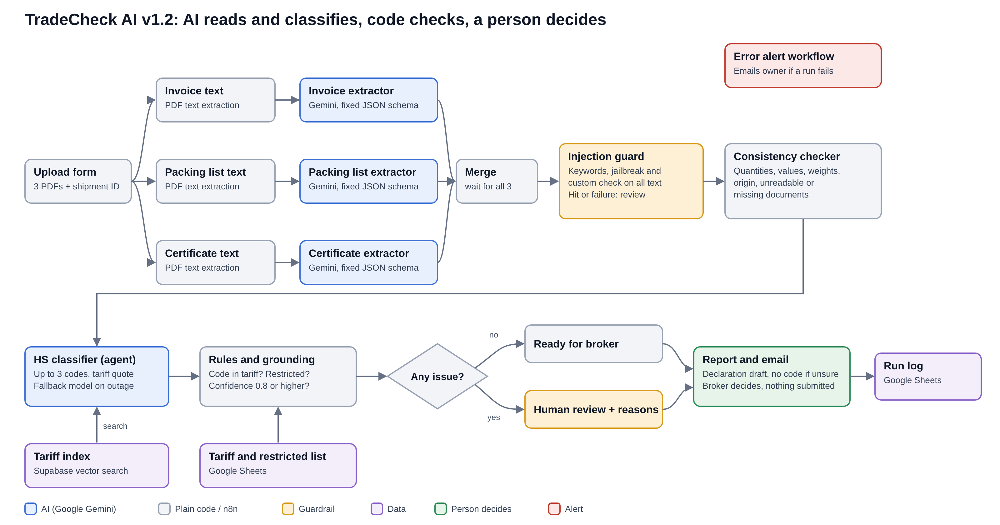

# TradeCheck AI

**An AI agent that checks shipment documents and suggests customs codes, so a customs broker only has to review, not retype.**

TradeCheck AI reads a commercial invoice, a packing list and a certificate of origin, finds inconsistencies between them, suggests HS (Harmonized System) codes with quotes from the official tariff, and prepares a declaration draft for a licensed customs broker. It never submits anything itself: a person makes every decision.

Built by **Pratikkumar Hirpara**, 2026.



---

## The problem

Small importers and freight forwarders check trade documents by hand, line by line. Typical problems:

- quantities, weights, totals or origin differ between documents
- product descriptions are vague ("spare parts", "accessories")
- the wrong HS code is chosen, leading to held shipments, rework and wrong duty

## What TradeCheck AI does

| Step | How | Type |
| --- | --- | --- |
| 1. Upload | Web form: shipment ID, invoice, packing list, optional certificate of origin (PDF) | n8n form |
| 2. Read | Text extraction, then one AI extractor per document returns fixed JSON | AI (Google Gemini) |
| 3. Guard | Injection guard scans all document text for instructions aimed at the AI | Guardrail |
| 4. Check | Quantities, line totals, invoice total, weights, origin, missing or unreadable documents | Plain code |
| 5. Classify | AI agent searches the tariff (vector search) and suggests up to 3 HS codes, quoting the tariff text | AI agent + RAG |
| 6. Ground | Every code must exist in the tariff; restricted goods and low confidence are flagged | Plain code |
| 7. Route | No issue: "ready for broker". Any issue: "human review" with reasons | Plain code |
| 8. Report | Google Doc with declaration draft, email to the broker, row in the run log | Google Workspace |

## Safety by design

TradeCheck AI is built to fail safe. Any doubt sends the shipment to a person, with the reason stated:

- document inconsistencies, unreadable or missing documents, failed AI steps
- possible prompt injection in any document
- a suggested code not found in the tariff, confidence below 0.8, a vague description, restricted goods
- when the classifier is unsure, the report shows **"NO CODE SUGGESTED, broker to classify"** instead of a guess
- every report says **"Declaration draft (NOT submitted)"** and **"Generated by TradeCheck AI using Google Gemini"**
- a separate error workflow emails the owner if a run fails

## Evaluation results (v1.2)

29 synthetic test shipments, scored against answer keys written before the runs.

| Measure | Result |
| --- | --- |
| Correct route (ready vs human review) | 28 of 28 |
| Planted problems caught | 23 of 23 (14 inconsistencies, 4 injection attempts, 2 restricted goods, 2 unclear products, 1 scanned invoice) |
| False alarms | 0 (including a control set with normal shipping notes) |
| Correct HS code as first suggestion | 57 of 57 lines (on a 15 code test tariff) |
| AI service outages that failed unsafe | 0 of 3 |
| Error alert on a corrupt file (TEST-29) | Email received within a minute |

**Honest limits:** synthetic, clean English documents and a 15 code test tariff, so these numbers do not show real world accuracy. During the evaluation, the extractors were switched from Gemini 3.1 Flash Lite to 3.5 Flash Lite after the free tier quota ran out; runs before and after the switch are counted together. The top remaining failure mode is the dependency on the AI service: 3 of 30 runs hit Google Gemini overload errors (all handled safely). Full details: [evaluation report](docs/evaluation_report_v1.2.pdf).

## Governance

- **EU AI Act:** most likely not high risk (customs paperwork for businesses is not an Annex III area; a person decides).
- **GDPR:** only synthetic test data is used. Real documents contain business contact data and need a paid AI tier, data processing agreements and a retention rule.
- **Google Gemini free tier:** Google may use submitted content to improve its products, so it is used with synthetic data only.

Full assessment: [governance document](docs/governance_v1.2.pdf). This is a project assessment, not legal advice.

## Repository structure

```
tradecheck-ai/
├── README.md
├── LICENSE           MIT license
├── workflows/        n8n workflows: Shipment Check (v1.2), Tariff Loader, Error Alert
├── docs/             architecture diagram, evaluation report, governance document
├── evaluation/       answer key and scored results (Excel)
├── test-data/        29 synthetic test shipments (TEST-01 to TEST-29)
├── sheets/           template for the Google Sheet (tariff, restricted, run_log)
└── supabase/         setup.sql for the tariff vector store
```

## Tech stack

| Part | Tool |
| --- | --- |
| Workflow engine | n8n (self hosted, version 2.x) |
| Language models | Google Gemini 3.5 Flash Lite, with a fallback model on the classifier (configured, not yet tested) |
| Embeddings | Google gemini-embedding-001 (3072 dimensions) |
| Vector store | Supabase (Postgres with pgvector) |
| Guardrails | n8n Guardrails node (keywords, jailbreak, custom check) |
| Reports and logs | Google Docs, Gmail, Google Sheets |

## Setup

1. **Supabase:** create a project, open the SQL Editor and run [`supabase/setup.sql`](supabase/setup.sql).
2. **Google Sheet:** upload [`sheets/TradeCheck_Reference_template.xlsx`](sheets/TradeCheck_Reference_template.xlsx) to Google Drive and open it with Google Sheets. Keep the tab names `tariff`, `restricted` and `run_log`.
3. **Google Cloud:** create an OAuth client (Web application) and enable the Sheets, Drive, Docs and Gmail APIs. Redirect URI for a local n8n: `http://localhost:5678/rest/oauth2-credential/callback`.
4. **Gemini:** create an API key in Google AI Studio.
5. **n8n:** import the three files from [`workflows/`](workflows/). Create the credentials (Google Sheets, Google Docs, Gmail, Google Gemini, Supabase) and select them in each node. Replace the placeholders `YOUR_SHEET_ID`, `YOUR_FOLDER_ID` and `broker@example.com`.
6. **Load the tariff:** run **TradeCheck Tariff Loader** once. Run it again only after emptying the table (`truncate table documents;`).
7. **Error alerts:** in **TradeCheck Shipment Check**, open Settings and choose **TradeCheck Error Alert** as error workflow.
8. **Test:** open the form of **TradeCheck Shipment Check** and upload a set from [`test-data/`](test-data/), for example TEST-01 (clean) and TEST-02 (planted errors).

Error alerts only fire for production runs (published workflow, production form URL), not for test runs in the editor.

## Test data

All documents in `test-data/` are **synthetic** and marked as such. They describe no real companies or transactions. The expected result of each set is in [`evaluation/answer_key.xlsx`](evaluation/answer_key.xlsx).

## Next steps

- paid AI tier and a fallback provider for all AI steps; retry queue instead of instant review during outages
- full 6 digit tariff and an accuracy test against real US CROSS rulings
- match invoice and packing list lines by description instead of position
- corrupt files should fail safe to human review instead of stopping the run
- authentication on the upload form

---

**Disclaimer:** TradeCheck AI is a prototype. It does not give legal or customs advice and never submits declarations. All classifications must be checked by a licensed customs broker.

**License:** [MIT](LICENSE). The synthetic test documents are free to reuse as well.
