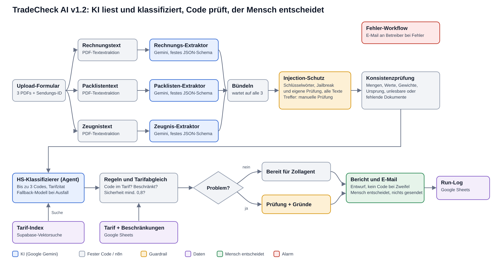
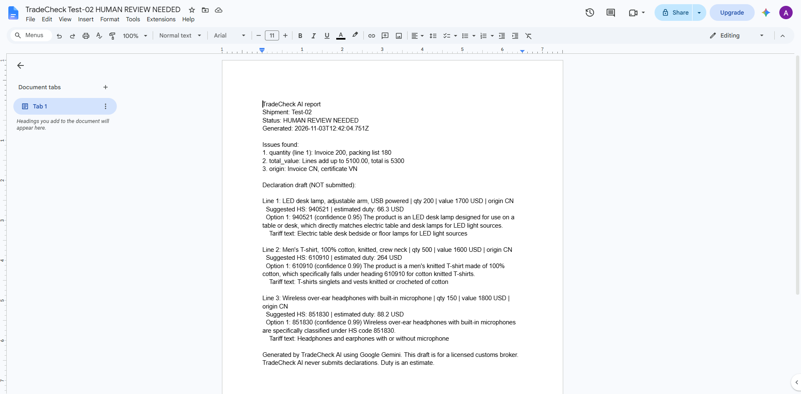

# TradeCheck AI

**Ein KI-Agent, der Importdokumente prüft und Zolltarifnummern vorschlägt, damit der Zollagent nur noch prüft und nichts mehr abtippt.**

TradeCheck AI liest Handelsrechnung, Packliste und Ursprungszeugnis, findet Abweichungen zwischen den Dokumenten, schlägt HS-Codes (Zolltarifnummern) mit Zitat aus dem offiziellen Tarif vor und erstellt einen Anmeldungsentwurf für einen zugelassenen Zollagenten. Das System reicht nie selbst etwas ein: Jede Entscheidung trifft ein Mensch.

Entwickelt von **Pratikkumar Hirpara**, 2026. Projekt für die Prüfung KI-Tool-Experte (IHK).

*English summary: see the [end of this page](#english-summary).*



---

## Das Problem

Zu jeder Importsendung gehören Rechnung, Packliste und oft ein Ursprungszeugnis. In kleinen Speditionen vergleicht ein Mitarbeiter diese Dokumente Zeile für Zeile und sucht danach für jedes Produkt den HS-Code. Das dauert rund **22 Minuten pro Sendung**. Typische Fehler:

- Mengen, Gewichte, Summen oder Ursprung passen zwischen den Dokumenten nicht zusammen
- Produktbeschreibungen sind unklar („spare parts“, „accessories“)
- ein falscher HS-Code führt zu angehaltenen Sendungen, Nacharbeit und falschem Zoll

## Was TradeCheck AI macht

| Schritt (n8n-Knoten) | Wie | Art |
| --- | --- | --- |
| 1. Sendung hochladen | Webformular: Sendungsnummer, Rechnung, Packliste, optional Ursprungszeugnis (PDF) | n8n-Formular |
| 2. Auslesen | Textauszug, dann je ein KI-Extraktor pro Dokument mit festem JSON-Schema | KI (Google Gemini) |
| 3. Injection-Schutz | Prüft alle Texte auf versteckte Anweisungen an die KI | Guardrail |
| 4. Konsistenzprüfung | Mengen, Positionssummen, Gesamtwert, Gewichte, Ursprung, fehlende oder unlesbare Dokumente | Fester Code |
| 5. HS-Klassifizierer | KI-Agent durchsucht den Tarif (Vektorsuche) und schlägt bis zu 3 HS-Codes mit Tarifzitat vor | KI-Agent + RAG |
| 6. Regeln und Tarifabgleich | Jeder Code muss im Tarif stehen; beschränkte Waren und geringe Sicherheit werden markiert | Fester Code |
| 7. Weiterleitung | Kein Problem: „bereit für Zollagent“. Sonst: manuelle Prüfung mit Begründung | Fester Code |
| 8. Bericht und Protokoll | Google Doc mit Anmeldungsentwurf, E-Mail an den Zollagenten, Zeile im Protokoll | Google Workspace |

**Grundsatz: Die KI liest und schlägt vor. Code prüft. Der Mensch entscheidet.**

## Sicherheit im Design

TradeCheck AI ist so gebaut, dass es im Zweifel sicher endet. Jeder Zweifel schickt die Sendung mit Begründung zu einem Menschen:

- Abweichungen zwischen Dokumenten, unlesbare oder fehlende Dokumente, fehlgeschlagene KI-Schritte
- möglicher Prompt-Injection-Versuch in einem Dokument
- ein Code, der nicht im Tarif steht, Sicherheit unter 0,8, unklare Beschreibung, beschränkte Ware
- ist der Klassifizierer unsicher, steht im Bericht **„NO CODE SUGGESTED, broker to classify“** statt einer Vermutung
- jeder Bericht trägt **„Declaration draft (NOT submitted)“** und **„Generated by TradeCheck AI using Google Gemini“**
- ein eigener Fehler-Workflow mailt dem Betreiber, wenn ein Lauf abbricht

## Evaluation (v1.2)

29 synthetische Testsendungen, bewertet mit Lösungsschlüsseln, die vor den Läufen geschrieben wurden.

| Kennzahl | Ergebnis |
| --- | --- |
| Richtige Weiterleitung (bereit oder manuelle Prüfung) | 28 von 28 |
| Eingebaute Probleme erkannt | 23 von 23 (14 Abweichungen, 4 Injection-Versuche, 2 beschränkte Waren, 2 unklare Produkte, 1 gescannte Rechnung) |
| Fehlalarme | 0 (auch bei einer Kontrollsendung mit normalen Versandhinweisen) |
| Richtiger HS-Code als erster Vorschlag | 57 von 57 Positionen (Testtarif mit 15 Codes) |
| KI-Ausfälle, die unsicher endeten | 0 von 3 |
| Fehler-E-Mail bei defekter Datei (TEST-29) | innerhalb einer Minute erhalten |

**Ehrliche Grenzen:** synthetische, saubere englische Dokumente und ein Testtarif mit 15 Codes; die Zahlen zeigen daher noch nicht die Genauigkeit im echten Betrieb. Die wichtigste Fehlerquelle ist die Abhängigkeit vom KI-Dienst: 3 von 30 Läufen trafen auf Überlastung bei Google Gemini (alle sicher behandelt). Details: [Evaluationsbericht](docs/evaluation_report_v1.2.pdf) (Englisch).

## Nachweis: ein vollständiger Lauf (TEST-02)

TEST-02 ist eine synthetische Sendung mit drei eingebauten Problemen. Der Produktionslauf dauerte **22,3 Sekunden** vom Upload bis zur E-Mail (n8n-Ausführung 950) und leitete die Sendung richtig zur manuellen Prüfung.

| Schritt | Screenshot |
| --- | --- |
| 1. Zollagent lädt Rechnung, Packliste und Ursprungszeugnis hoch | [01_form.png](screenshots/01_form.png) |
| 2. Der Workflow läuft vollständig durch | [02_execution.png](screenshots/02_execution.png) |
| 3. E-Mail an den Zollagenten mit Problemen und Anmeldungsentwurf | [04_email.png](screenshots/04_email.png) |
| 4. Bericht im Google Doc: Abweichungen bei Menge, Gesamtwert und Ursprung, HS-Codes mit Tarifzitat | [05_report.png](screenshots/05_report.png) |



E-Mail-Adressen und Links sind in den Screenshots geschwärzt. Die Screenshots stammen aus der Version vor der Umbenennung der Knoten ins Deutsche; die Funktion ist unverändert.

## Wirtschaftlichkeit

Bei 300 Sendungen im Monat kostet die manuelle Prüfung rund **4.950 €** Personalzeit pro Monat. Mit TradeCheck AI, einschließlich Prüfzeit des Zollagenten und der 10 % Läufe, die im Test auf Handprüfung zurückfielen, sind es rund **2.302 €**. Ersparnis: **2.648 € pro Monat**, Amortisation der geschätzten 4.500 € Aufbauaufwand nach **1,7 Monaten** (3,1 Monate im ungünstigsten Fall). KI-Kosten im bezahlten Tarif: etwa **2,4 Cent pro Sendung**. Jeder Wert ist als gemessen, angenommen oder nicht verlässlich quantifizierbar gekennzeichnet.

Details: [Business Case](business/TradeCheck_AI_Business_Case_DE.pdf) und [ROI-Modell](business/TradeCheck_AI_ROI_Modell.xlsx).

## Governance

- **EU AI Act:** voraussichtlich kein Hochrisiko-System (Zollpapiere für Unternehmen gehören nicht zu Anhang III; ein Mensch entscheidet).
- **DSGVO:** nur synthetische Testdaten. Echte Dokumente enthalten Kontaktdaten und erfordern einen bezahlten KI-Tarif, Auftragsverarbeitungsverträge und eine Löschfrist.
- **Google Gemini, kostenloser Tarif:** Google darf eingereichte Inhalte nutzen, deshalb nur mit synthetischen Daten.

Vollständige Bewertung: [Governance-Dokument](docs/governance_v1.2.pdf) (Englisch) und Kapitel 5 der [Projektdokumentation](docs/TradeCheck_AI_Projektdokumentation.pdf). Projektbewertung, keine Rechtsberatung.

## Dokumente

| Dokument | Datei |
| --- | --- |
| Präsentation (PDF) | [presentation/TradeCheck_AI_Praesentation.pdf](presentation/TradeCheck_AI_Praesentation.pdf) |
| Präsentation, animiert (herunterladen und im Browser öffnen) | [presentation/TradeCheck_AI_Praesentation.html](presentation/TradeCheck_AI_Praesentation.html) |
| Projektdokumentation | [docs/TradeCheck_AI_Projektdokumentation.pdf](docs/TradeCheck_AI_Projektdokumentation.pdf) |
| Business Case und ROI-Modell | [business/](business/) |
| Evaluationsbericht und Governance (Englisch) | [docs/](docs/) |

## Aufbau des Repositorys

```
tradecheck-ai/
├── README.md
├── LICENSE           MIT-Lizenz
├── workflows/        n8n-Workflows: Sendungsprüfung, Fehler-Workflow, Tarif-Loader
├── presentation/     Präsentation (PDF und animierte HTML-Version)
├── docs/             Projektdokumentation, Architektur, Evaluationsbericht, Governance
├── business/         Business Case und ROI-Modell (Deutsch und Englisch)
├── screenshots/      Nachweis eines vollständigen Laufs (TEST-02)
├── evaluation/       Lösungsschlüssel und Ergebnisse (Excel)
├── test-data/        29 synthetische Testsendungen (TEST-01 bis TEST-29)
├── sheets/           Vorlage für das Google Sheet (tariff, restricted, run_log)
└── supabase/         setup.sql für den Tarif-Vektorspeicher
```

## Technik

| Teil | Werkzeug |
| --- | --- |
| Workflow | n8n (selbst gehostet, Version 2.x) |
| Sprachmodelle | Google Gemini 3.5 Flash Lite, Fallback-Modell Gemini 3.8 Flash beim Klassifizierer (eingerichtet, noch nicht getestet) |
| Embeddings | Google gemini-embedding-001 (3.072 Dimensionen) |
| Vektorspeicher | Supabase (Postgres mit pgvector) |
| Guardrails | n8n-Guardrails-Knoten (Schlüsselwörter, Jailbreak, eigene Prüfung) |
| Berichte und Protokoll | Google Docs, Gmail, Google Sheets |

## Einrichtung

1. **Supabase:** Projekt anlegen, im SQL Editor [`supabase/setup.sql`](supabase/setup.sql) ausführen.
2. **Google Sheet:** [`sheets/TradeCheck_Reference_template.xlsx`](sheets/TradeCheck_Reference_template.xlsx) in Google Drive hochladen und mit Google Sheets öffnen. Die Tabellenblätter `tariff`, `restricted` und `run_log` nicht umbenennen.
3. **Google Cloud:** OAuth-Client (Webanwendung) anlegen und die APIs für Sheets, Drive, Docs und Gmail aktivieren. Redirect-URI für ein lokales n8n: `http://localhost:5678/rest/oauth2-credential/callback`.
4. **Gemini:** API-Schlüssel in Google AI Studio erstellen.
5. **n8n:** die drei Dateien aus [`workflows/`](workflows/) importieren. Zugangsdaten anlegen (Google Sheets, Google Docs, Gmail, Google Gemini, Supabase) und in jedem Knoten auswählen. Platzhalter ersetzen: `YOUR_GOOGLE_SHEET_ID`, `YOUR_DRIVE_FOLDER_ID`, `broker@example.com` und `operator@example.com`.
6. **Tarif laden:** **TradeCheck Tarif-Loader** einmal ausführen. Erneut nur nach Leeren der Tabelle (`truncate table documents;`).
7. **Fehler-E-Mails:** in **TradeCheck Sendungsprüfung** unter Settings **TradeCheck Fehler-Workflow** als Error Workflow auswählen.
8. **Test:** das Formular von **TradeCheck Sendungsprüfung** öffnen und einen Satz aus [`test-data/`](test-data/) hochladen, zum Beispiel TEST-01 (sauber) und TEST-02 (eingebaute Fehler).

Fehler-E-Mails kommen nur bei Produktionsläufen (veröffentlichter Workflow, Produktions-URL des Formulars), nicht bei Testläufen im Editor. Die Formularfelder sind bewusst englisch benannt, weil der Code die Feldnamen verwendet.

## Testdaten

Alle Dokumente in `test-data/` sind **synthetisch** und als solche gekennzeichnet. Sie beschreiben keine echten Firmen oder Geschäfte. Das erwartete Ergebnis jedes Satzes steht in [`evaluation/answer_key.xlsx`](evaluation/answer_key.xlsx).

## Nächste Schritte

- bezahlter KI-Tarif und getestetes Fallback-Modell für alle KI-Schritte
- vollständiger 6-stelliger Tarif und Test gegen echte Zollentscheidungen (US CROSS)
- Texterkennung (OCR) für gescannte PDFs
- defekte Dateien zur manuellen Prüfung leiten, statt den Lauf zu stoppen
- Anmeldung für das Upload-Formular
- dreimonatiger Pilot mit einer Spedition, um die echten Zeiten zu messen

---

## English summary

**TradeCheck AI** is an n8n workflow that checks import shipment documents (commercial invoice, packing list, certificate of origin) and suggests HS customs codes for a licensed customs broker to approve. Google Gemini reads the documents and suggests codes taken only from the official tariff, quoting the tariff text; plain code checks all numbers, rules and routing; a person makes every decision and nothing is submitted automatically.

- **Results (v1.2, 29 synthetic shipments):** 28 of 28 routed correctly, 23 of 23 planted problems caught, 0 false alarms, 57 of 57 HS codes correct on a 15 code test tariff, 0 of 3 AI outages failed unsafe.
- **Business case:** for 300 shipments a month, about €2,648 saved per month, payback in 1.7 months, AI cost about 2.4 cents per shipment on the paid tier.
- **Limits:** synthetic documents and a small test tariff; a corrupt file still stops the run (the operator is alerted by email).
- **Documents:** the presentation and project documentation are in German; the [evaluation report](docs/evaluation_report_v1.2.pdf), [governance document](docs/governance_v1.2.pdf), [business case](business/TradeCheck_AI_Business_Case.pdf) and [ROI model](business/TradeCheck_AI_ROI_Model.xlsx) are also available in English.
- **Setup:** see the German setup steps above; node and workflow names in n8n are German.

---

**Hinweis / Disclaimer:** TradeCheck AI ist ein Prototyp. Es gibt keine Rechts- oder Zollberatung und reicht nie Anmeldungen ein. Alle Einreihungen muss ein zugelassener Zollagent prüfen. *TradeCheck AI is a prototype; all classifications must be checked by a licensed customs broker.*

**Lizenz / License:** [MIT](LICENSE). Die synthetischen Testdokumente dürfen ebenfalls frei verwendet werden.
